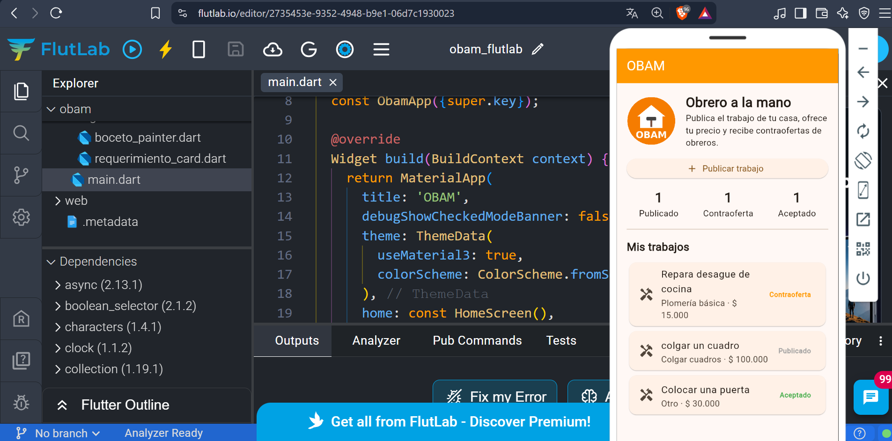
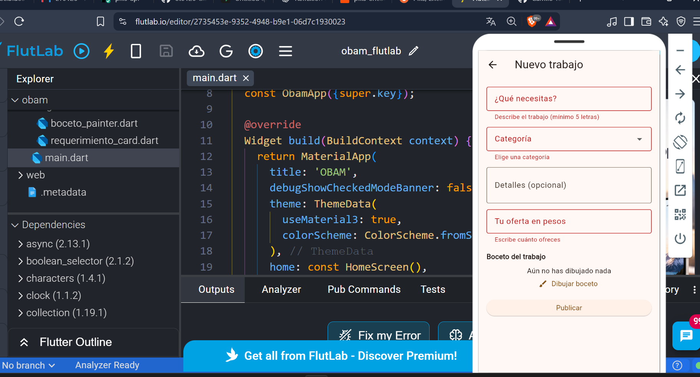
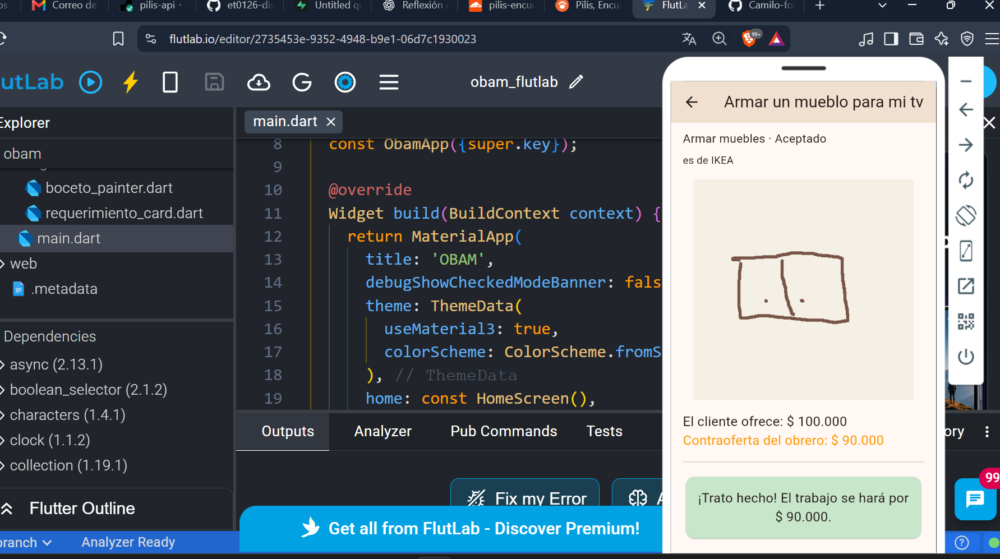

# OBAM · Obrero a la mano

Taller integrador ET0126 · Programación de Dispositivos Móviles · I.U. Pascual Bravo

> Mi app se llama **OBAM (Obrero a la mano)**. Está dirigida a **personas que necesitan arreglos pequeños en su casa**, quienes necesitan **encontrar rápido a alguien para colgar un cuadro o instalar un TV y acordar un precio justo**. La app le ayudará a **publicar el trabajo y negociar el precio con un obrero** mediante **la publicación de requerimientos con boceto, una oferta de precio y las contraofertas del obrero**.

## Propuesta

1. **Nombre:** OBAM, Obrero a la mano.
2. **Usuario:** personas que necesitan arreglos pequeños en casa (colgar cuadros, instalar un TV, armar muebles) y los obreros que hacen esos trabajos.
3. **Problema:** para un trabajo pequeño es difícil conseguir a alguien de confianza y saber cuánto pagar.
4. **Solución:** funciona como InDriver, pero para trabajos de casa. El usuario publica lo que necesita y ofrece un precio; el obrero puede aceptar ese precio o contraofertar.
5. **Funciones iniciales:**
   - Publicar un trabajo con título, categoría, precio ofrecido y un boceto.
   - Ver la lista de mis trabajos con su estado.
   - Recibir una contraoferta del obrero y aceptarla o rechazarla.
6. **Recorrido principal:**
   1. Abro la app y veo mis trabajos y un resumen por estado.
   2. Toco **Publicar trabajo**, lleno el formulario y dibujo el boceto.
   3. Publico; el trabajo aparece en la lista como *Publicado*.
   4. Abro el trabajo; en **Modo obrero** se simula la contraoferta con los botones + y −.
   5. Acepto o rechazo la contraoferta.
7. **Datos:** título, categoría, detalles (opcional), precio ofrecido, contraoferta, estado y los puntos del boceto.
8. **Canvas:** en lugar de una foto, el usuario dibuja con el dedo un boceto de dónde va el trabajo (por ejemplo, la pared y el lugar del TV). El boceto se ve en el detalle para que el obrero entienda qué hay que hacer.

> **Nota:** en esta versión la contraoferta del obrero se simula en el mismo celular. Todavía no hay usuarios ni servidor; eso llega con Firebase en la Unidad 3.

## Estructura

```text
lib/
  main.dart                         MaterialApp y tema
  models/requerimiento.dart         Clase Requerimiento, categorías (Set), formatearPrecio (while)
  services/requerimiento_service.dart  Guardar/cargar con SharedPreferences y resumen (Map)
  screens/home_screen.dart          Inicio: descripción, botón principal, resumen y lista
  screens/crear_screen.dart         Formulario con validación
  screens/boceto_screen.dart        Dibujo con el dedo (Canvas)
  screens/detalle_screen.dart       Detalle, contraoferta, aceptar/rechazar
  widgets/requerimiento_card.dart   Tarjeta sin estado de cada trabajo
  widgets/boceto_painter.dart       CustomPainter que dibuja el boceto
assets/images/logo_obam.png
```

## Almacenamiento: ¿por qué SharedPreferences?

Uso **SharedPreferences** porque la app guarda pocos trabajos y con pocos campos. Convierto la lista a texto JSON (`jsonEncode`) y la guardo con una sola llave. Al abrir la app, la leo y la convierto otra vez en objetos (`jsonDecode` + `requerimientoDesdeMap`). Si más adelante hay muchos registros o búsquedas, lo cambiaría por SQLite o Firebase.

## Conceptos de Dart en mi app

| Concepto | Dónde |
|---|---|
| Tipos, `final`/`const` y null safety | `models/requerimiento.dart`: `descripcion` y `contraoferta` son nullable porque pueden faltar; el resto no. |
| Clases y objetos | Clase `Requerimiento` con constructor y métodos `contraofertar()`, `aceptar()`, `rechazar()` y `precioFinal()`. Se crean objetos en `crear_screen.dart` y al cargar con `requerimientoDesdeMap()`. |
| Funciones | `validarPrecio()` en `crear_screen.dart`, `formatearPrecio()` y `requerimientoDesdeMap()` en el modelo. |
| `List` | `List<Requerimiento>` en `home_screen.dart` y los puntos del boceto `List<Offset?>`. |
| `Set` | `categorias` en el modelo: una categoría no se puede repetir. |
| `Map` | `contarPorEstado()` en el servicio devuelve cuántos trabajos hay por estado. También `toMap()` para guardar. |
| `if` y `for` | `if` en las validaciones y en el color del estado de la tarjeta; `for` para recorrer la lista, contar estados y dibujar las líneas del boceto. |
| `while` | `formatearPrecio()`: recorre las cifras del precio de derecha a izquierda y pone un punto cada tres cifras (`120000` → `$ 120.000`). Es finito porque termina al llegar a la primera cifra. |

## Stateless y Stateful

- **StatelessWidget:** `ObamApp`, `RequerimientoCard` (solo recibe datos y una acción).
- **StatefulWidget:** `HomeScreen` (lista y carga), `CrearScreen` (formulario y boceto), `BocetoScreen` (puntos que se dibujan) y `DetalleScreen` (precio de la contraoferta con + y −).

## Cómo ejecutar

En el repositorio solo están los archivos de clase (`lib`, `assets`, `pubspec.yaml`). Las carpetas de Android y las demás plataformas se generan con `flutter create`:

```bash
git clone https://github.com/Camilo-fonseca237/et0126-obam.git
cd et0126-obam
flutter create . --project-name obam
flutter pub get
flutter run
```

También se puede ejecutar en FlutLab (flutlab.io) subiendo el proyecto.

**Prueba de persistencia:** publica un trabajo, cierra la app por completo y ábrela otra vez. El trabajo y su estado siguen en la lista.

## Ejecución

Probé la app en el emulador Android de Android Studio, pero el emulador mostraba la pantalla deformada, así que terminé de probarla en FlutLab. El código es el mismo para Android.

## Capturas

| Inicio | Validación | Contraoferta |
|---|---|---|
|  |  |  |

## Uso de IA

Usé Claude (IA) como apoyo para estructurar el proyecto, generar una primera versión del código, simplificarlo a lo visto en clase y resolver errores de configuración del entorno. Revisé y probé cada parte, y puedo explicar y modificar cualquier archivo.
